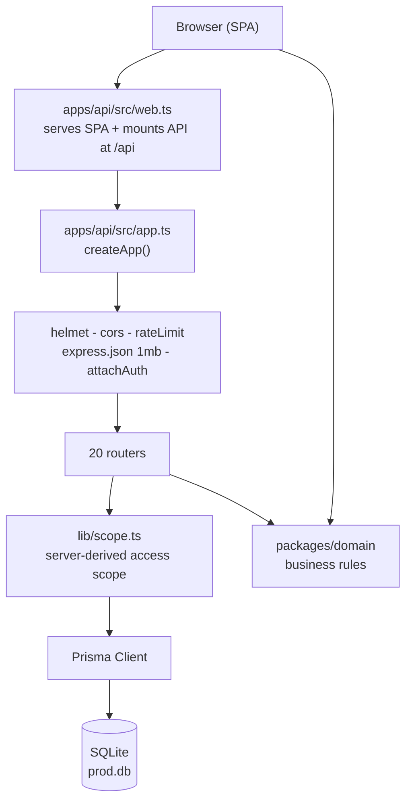
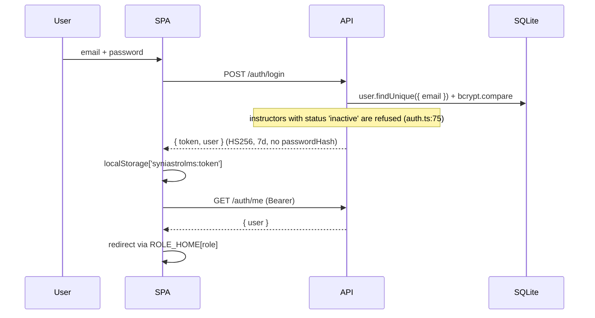
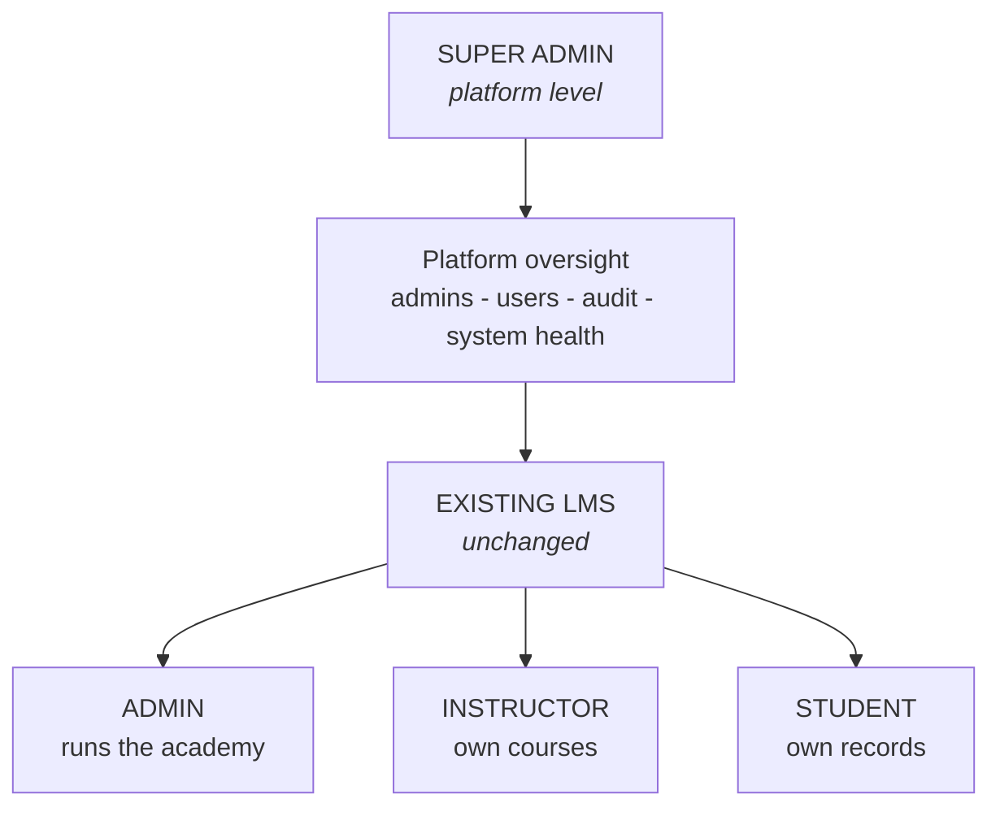
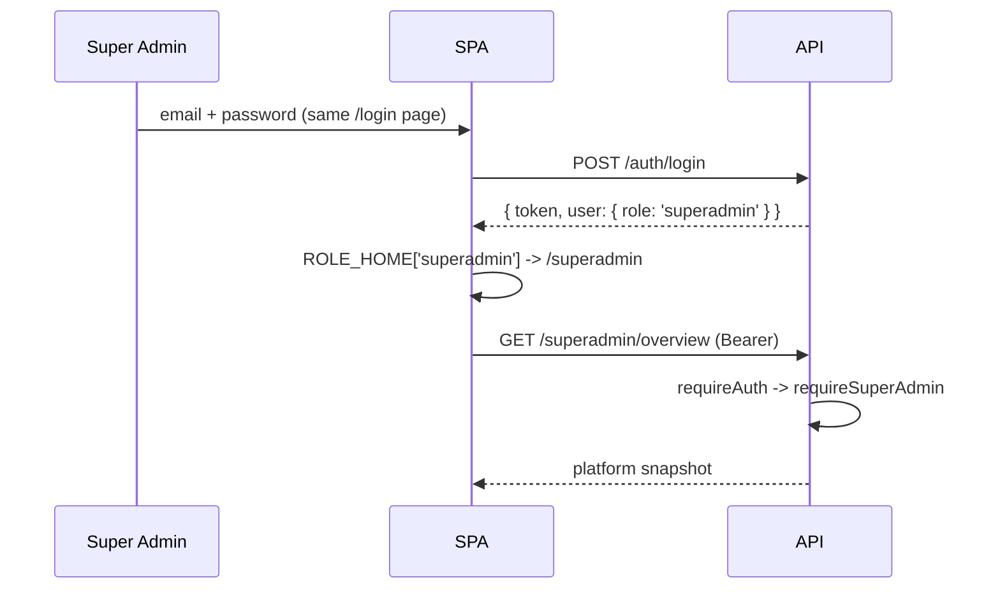
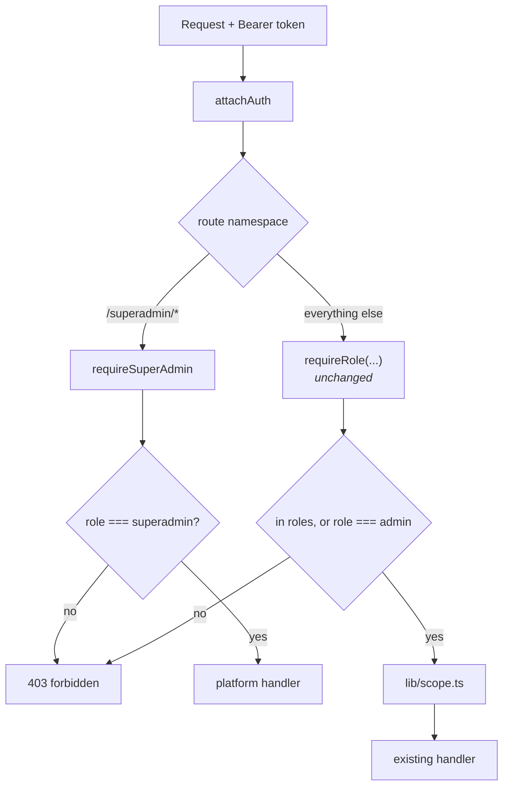
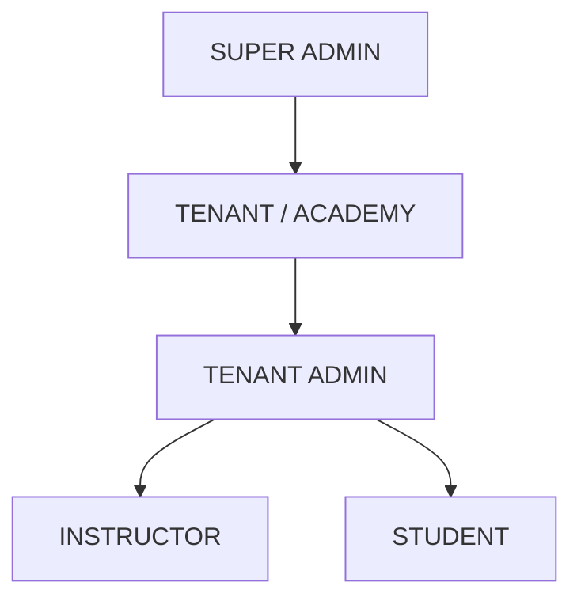
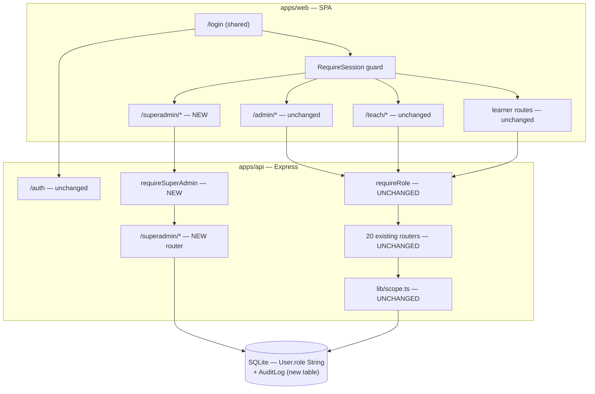

# 11 — Super Admin Flow

> **Since 1 Nov 2026 the product is one centralized learning platform, not multi-tenant SaaS.** Where this document describes academies, plans, subscriptions, invoices or per-academy gateways, [`16-PLATFORM-CONVERSION.md`](16-PLATFORM-CONVERSION.md) is the current account and this text is history.

**Status:** **built and in the codebase** (Phases 1–15, 19 September 2026). This file is both the
design that was followed and the record of what was built — §24 states what the code does today,
and where it differs from the plan above, §24 is the one that is true.
**Scope:** add a fourth role, `superadmin`, to the existing LMS. Nothing else.

> **Explicitly out of scope for this phase:** Tenant, `tenantId`, Academy, Organization,
> multi-tenancy, subscriptions, plans, billing, SaaS migration, tenant-scoped Admin, data
> isolation, PostgreSQL migration, mobile changes. See §21 for the conceptual future only.

---

## 1. Project Overview

ZuviloAI is a single-academy LMS, already built and **running in production** at
`https://zuviloai.com`. It is an npm-workspaces monorepo:

| Workspace | Stack | Role |
| --- | --- | --- |
| `apps/web` | React 18.3.1, Vite 7, react-router-dom 6, CSS Modules | Frontend SPA |
| `apps/api` | Express 4, Prisma 6, SQLite, JWT (HS256) | Backend API |
| `packages/domain` | Pure TypeScript | Shared types **and** business rules |

In production a **single PM2 process** runs `tsx src/index.ts`: `apps/api/src/web.ts` mounts the API
at `/api` and serves the built SPA for every other path.

This document adds Super Admin **without changing any of the above**.

---

## 2. Existing Architecture



**Middleware order** (`apps/api/src/app.ts:32-73`), unchanged by this work:
`trust proxy` → `x-powered-by` off → `helmet` → `cors` (single origin) → global rate limit →
`express.json({ limit: '1mb' })` → `attachAuth` → `GET /health` → routers → JSON 404 → `errorHandler`.

**Frontend service seam** (`apps/web/src/services/index.ts`): `VITE_API_MODE` selects
`httpServices` or `mockServices`. All 22 service groups in `contracts.ts` have real HTTP clients.

---

## 3. Existing Roles

Defined in exactly one place — `packages/domain/src/identity.ts:3`:

```ts
export type Role = 'student' | 'instructor' | 'admin';
```

| Role | How it is created | Linkage | Workspace |
| --- | --- | --- | --- |
| `student` | Public registration (`POST /auth/register`) | `Student.userId` 1:1 | `/home` |
| `instructor` | Admin invite (`POST /instructors`) | `User.instructorId` FK | `/teach` |
| `admin` | **Seed script only** — `prisma/seed.ts:51` | neither | `/admin` |

> **Finding:** there is **no way to create an admin account through the application**. The only
> admin is created by `prisma/seed.ts:51` (`admin@syniastrolms.test`). `docs/02` confirms
> "standalone user management" is deliberately not in the project. This is the clearest
> justification for Super Admin's first real capability (§10).

---

## 4. Existing Admin Flow

1. `POST /auth/login` → `{ token, user }` (`apps/api/src/routes/auth.ts:67`).
2. Token stored in `localStorage` under `syniastrolms:token` (`services/http/client.ts:4`).
3. `LoginPage` redirects via `ROLE_HOME` (`pages/marketing/LoginPage.tsx:17`) → `/admin`.
4. `RequireSession` (`app/router.tsx:198`) allows `/admin/*` only when `role === 'admin'`.
5. `AppShell` renders `navigation.admin` (`shell/navigation.tsx:94-155`).
6. Every admin API call carries `Authorization: Bearer <jwt>`; routes gate with `requireRole(...)`.

Admin-exclusive endpoints today (`requireRole('admin')`): `students.ts:428` (suspend),
`categories.ts:92,115,141`, `settings.ts:24` (`PUT /settings/:section`), `instructors.ts:313,347,386,397`,
`certificates.ts:174,202,279,305`, `reports.ts:672` (instructors report).

---

## 5. Current Authentication Flow

Stateless JWT. **No cookies, no server sessions, no refresh token, no `/auth/logout`, no revocation list.**



- **Token payload** (`lib/auth.ts:24-29`): `{ sub, role, studentId?, instructorId? }`.
  `role`, `studentId`, `instructorId` are **baked in at login** and never re-read per request.
- `attachAuth` (`lib/auth.ts:52`) is global; an invalid/expired token is **silently ignored** and the
  request continues anonymous.
- **Logout is client-side only** — `httpAuth.logout()` clears `localStorage`. The JWT stays valid
  for its full 7 days.
- 401 from any call clears the token and fires `syniastrolms:unauthorized`; `SessionProvider`
  drops to signed-out and `RequireSession` redirects to `/login?next=` (guarded by `lib/safeNext.ts`).

---

## 6. Current Authorization Flow

**Backend-enforced.** Frontend guards are convenience only. Two independent layers:

**Layer 1 — role gate**, `requireRole` (`apps/api/src/lib/auth.ts:70-76`):

```ts
export function requireRole(...roles: Role[]) {
  return (req, _res, next) => {
    if (!req.auth) return next(unauthorized());
    if (!roles.includes(req.auth.role) && req.auth.role !== 'admin') return next(forbidden());
    next();
  };
}
```

> **Critical:** `admin` is a **universal bypass** on every `requireRole` call. `requireRole('instructor')`
> on the calendar routes therefore also admits admins.

**Layer 2 — data scope**, `apps/api/src/lib/scope.ts`. Its header states the invariant:
*"Never read a role, instructor id or student id from the request body or query — the token is the
only source."* Out-of-scope ids answer **404, not 403**, so ids cannot be enumerated.

```ts
export function instructorScope(req: Request): string | undefined {
  const auth = req.auth;
  if (!auth) throw unauthorized();
  if (auth.role === 'admin') return undefined;          // unscoped = sees everything
  if (auth.role === 'instructor') { ...return auth.instructorId; }
  throw forbidden();                                     // <-- any other role is refused
}
```

Helpers: `courseScopeWhere`, `scopedCourseIds`, `studentScopeWhere`, `assertCourseAccess`,
`assertQuizAccess`, `assertAssignmentAccess`, `assertSubmissionAccess`, `assertLiveAccess`,
`assertCertificateAccess`, `assertStudentAccess`, `requireStudent`, `requireEnrollment`,
`requireLessonAccess`, `requireUser`.

---

## 7. Current Database Role Structure

`apps/api/prisma/schema.prisma:20-39`:

```prisma
model User {
  id           String   @id @default(cuid())
  email        String   @unique
  passwordHash String
  name         String
  role         String // 'student' | 'instructor' | 'admin'
  descriptor   String   @default("")
  instructorId String?
  ...
}
```

> ### The single most important finding in this document
> **`role` is a plain `String` column.** There is **no Prisma `enum`**, and grepping all six
> migrations for `CHECK` or `ENUM` returns **nothing**. SQLite does not support enums, so every
> status/role in this schema is a `String` with the allowed values written only as a *comment*.
>
> **Therefore adding `superadmin` requires ZERO database migration.** The value can be stored today.
> The `Role` union in `packages/domain/src/identity.ts` is the only enforcement, and it is
> compile-time only. `toProfile` (`routes/auth.ts:18`) blind-casts `user.role as Role`.

Related: `Settings` is an explicit singleton (`id Int @id @default(1)`) — untouched by this phase.

---

## 8. Super Admin Objective

Introduce a **fourth, separate, platform-level** role that:

- does **not** replace, rename, convert or absorb the existing `admin`;
- leaves every existing role's behaviour **byte-for-byte identical**;
- is enforced by the **backend**, not the frontend;
- fills the genuine gaps the current system has: **no way to create an admin**, **no user directory**,
  **no audit trail**, **no operational visibility** (notably the `EmailOutbox` that nothing drains).

---

## 9. Proposed Role Hierarchy



**Design decision — Super Admin is a SEPARATE namespace, not an elevated Admin.**

Two options were considered:

| Option | Description | Verdict |
| --- | --- | --- |
| **A. Inherit** — add `\|\| role === 'superadmin'` to the `requireRole` bypass | Superadmin instantly reaches all ~110 existing endpoints | **Rejected.** It exposes 110 endpoints never designed or tested for this role, and `instructorScope()` still `throw forbidden()` for superadmin, so list/report/dashboard routes would fail inconsistently *after* passing the role gate. Maximum regression surface. |
| **B. Separate namespace** — new `/superadmin/*` API + `requireSuperAdmin` middleware | Superadmin gets purpose-built platform endpoints; existing routes untouched | **Recommended.** Zero change to any existing route. Regression risk approaches zero. |

Under Option B, **Super Admin cannot author courses or change academy settings** — those remain
Admin's job, which is exactly what "must not replace Admin" requires.

---

## 10. Super Admin Responsibilities

Derived from what the codebase actually has and actually lacks.

### A. Required (build in this phase)

| Capability | Why it is required | Backed by |
| --- | --- | --- |
| **Platform dashboard** | Entry point; no platform-level view exists | counts over `User`, `Course`, `Enrollment` |
| **Admin management** — list / create / deactivate admin accounts | **The real gap.** Admins can only be created by `prisma/seed.ts:51` today | `User` where `role='admin'` |
| **User directory** (all roles, read + status) | `docs/02` records "standalone user management" as absent | `User` + `Student` + `Instructor` |
| **Audit log** (who did what, when) | Nothing of the kind exists; privileged actions are untraceable | new `AuditLog` model |
| **System health** — `EmailOutbox` queue depth, `MediaAsset` storage, scheduler heartbeat | `lib/mail.ts` only INSERTs; **nothing drains the outbox**, so password resets and invites silently never send | `EmailOutbox`, `MediaAsset` |

### B. Optional (defer unless asked)

- Platform-wide read-only reports (could reuse `lib/reports.ts`).
- Read-only course/enrolment overview.
- Session/token revocation UI — **blocked**: no revocation infrastructure exists (§17).
- Impersonation / "act as admin" — powerful, needs audit + consent design. Not phase 1.

### C. Must remain Admin-only (do NOT move)

Course / chapter / lesson authoring · Categories · Quiz & assignment authoring · Submission review
and grading · Certificate issuing, revoking, templates · Live class scheduling · Calendar ·
Enrollment management · Instructor invitation · **Academy `Settings` (all six sections)**.

These are *academy operations*. Moving any of them would convert Super Admin into Admin, which the
brief forbids.

---

## 11. Admin vs Super Admin Permission Matrix

Every row is derived from actual code, with the deciding file cited.

| Module | Super Admin | Admin | Instructor | Student | Basis |
| --- | --- | --- | --- | --- | --- |
| Platform dashboard | **Yes (new)** | No | No | No | new `/superadmin/overview` |
| Admin account management | **Yes (new)** | No | No | No | closes the `seed.ts:51`-only gap |
| Audit log | **Yes (new)** | No | No | No | new `AuditLog` |
| System health / EmailOutbox | **Yes (new)** | No | No | No | `lib/mail.ts` has no drain |
| User directory (read) | **Yes (new)** | No | No | No | no such module today |
| Academy dashboard `/dashboard` | No | Yes | Own scope | No | `dashboard.ts:66` |
| Courses / chapters / lessons | No | Yes | Own courses | No | `courses.ts`, `chapters.ts`, `lessons.ts` |
| Categories | No | Yes | Read | No | `categories.ts:92,115,141` |
| Quizzes / assignments | No | Yes | Own courses | Attempt/submit | `quizzes.ts`, `assignments.ts` |
| Submission review | No | Yes | Own courses | No | `assignments.ts:527` |
| Students module | No | Yes | Own learners | No | `students.ts:76` |
| Student suspend | No | Yes | No | No | `students.ts:428` |
| Instructors module | No | Yes | Read | No | `instructors.ts:313` |
| Certificates issue/revoke/templates | No | Yes | Issue (own) | Own wallet | `certificates.ts:174,279` |
| Live classes | No | Yes | Own courses | Register | `live.ts:52` |
| Calendar | No | Yes | Own scope | No | `calendar.ts:145` |
| Academy Settings | **No — deliberate** | Yes | Read | No | `settings.ts:24` |
| Reports | Optional (B) | Yes | Own scope | No | `reports.ts:359,672` |
| Learning routes | No | No | No | Yes | `learning.ts` |

**Explanation of the two entries that most often surprise reviewers:**

- **Super Admin has NO academy Settings access.** `Settings` is the academy's operating
  configuration (completion thresholds, certificate rules, enrolment policy). It is `admin`'s
  instrument. Granting it to Super Admin would make Super Admin a second Admin.
- **Super Admin has NO course management.** Same reasoning. Platform oversight ≠ academy operation.

---

## 12. Authentication Flow (with Super Admin)

**No change to the login endpoint, token format, hashing, or storage.** `POST /auth/login` already
returns whatever `role` the `User` row holds, and `toProfile` already casts it through.



Required changes are **additive only**:

1. `packages/domain/src/identity.ts` — extend the union to include `'superadmin'`.
2. `ROLE_HOME` (`LoginPage.tsx:17`) — add `superadmin: '/superadmin'`.
3. `homeFor` (`router.tsx:182`) — add a `superadmin` branch (see §18 — this one is a **bug risk**).

Super Admin creation: **no self-registration** (`auth.ts:55` hard-codes `role: 'student'` and must
stay that way). The first Super Admin is created by a **separate, idempotent, one-off script** —
not by extending `prisma/seed.ts`, because `seed.ts` **deletes every row** before inserting
(`seed.ts:15-24`) and must never run against production.

---

## 13. Authorization Flow (with Super Admin)

New middleware beside the existing one, in `apps/api/src/lib/auth.ts`:

```ts
// Proposed — NOT yet implemented.
export function requireSuperAdmin(req, _res, next) {
  if (!req.auth) return next(unauthorized());
  if (req.auth.role !== 'superadmin') return next(forbidden());
  next();
}
```

> **`requireRole` itself is NOT modified.** Because its bypass clause is `role !== 'admin'`, a
> `superadmin` token is **already refused by every existing endpoint** — it fails closed. That is
> precisely the behaviour we want, and it is why Option B in §9 carries almost no regression risk.



**Deliberately unchanged:** `instructorScope()` keeps throwing `forbidden()` for `superadmin`.
Super Admin endpoints are platform-wide by definition and never call it.

---

## 14. Frontend Route Architecture

### Current

| Path | Guard (`router.tsx:198-212`) |
| --- | --- |
| `/admin/*` | `role === 'admin'` |
| `/teach/*` | `role !== 'student'` |
| `/home`, `/my-learning`, `/learn`, `/assignments`, `/assessments`, `/certificates`, `/live` | `role === 'student'` |
| `/login`, `/register`, `/welcome`, `/verify`, `/support`, `/courses` | public |

### Proposed

| Path | Page | Guard |
| --- | --- | --- |
| `/superadmin` | Platform overview | `role === 'superadmin'` |
| `/superadmin/admins` | Admin management | `role === 'superadmin'` |
| `/superadmin/users` | User directory | `role === 'superadmin'` |
| `/superadmin/audit` | Audit log | `role === 'superadmin'` |
| `/superadmin/system` | System health / outbox | `role === 'superadmin'` |

Guard additions in `RequireSession` (additive; existing three lines untouched):

```tsx
// Proposed
if (startsWithAny(path, ['/superadmin']) && role !== 'superadmin') return <Navigate to={homeFor(role)} replace />;
```

**Component reuse — do not duplicate.** `AppShell`, `Sidebar`, `Header`, `PageHeader`, `DataTable`,
`Badge`, `Button`, `Menu`, `Pagination`, `Feedback`, `useAsync`, `ToastProvider` are all role-agnostic.
Super Admin needs **no new layout**, only:
- a new `navigation.superadmin` entry (`shell/navigation.tsx:52`),
- entries in `bottomDestinations` and `workspaceLabel`,
- new page components under `apps/web/src/pages/superadmin/`,
- a `services/http/superadmin.ts` client + a `superadmin` group in `contracts.ts`.

`useWorkspace()` is **not** extended — it maps `/admin` vs `/teach` only, and Super Admin is neither.

---

## 15. Backend API Architecture

### Current mounts (`apps/api/src/app.ts:47-68`) — all unchanged

`/health` `/auth` `/catalog` `/courses` `/categories` `/courses/:courseId/chapters`
`/courses/:courseId/lessons` `/students` `/instructors` `/learning` `/quizzes` `/assignments`
`/certificates` `/live` `/calendar` `/notifications` `/settings` `/help` `/reports` `/dashboard` `/media`

### Proposed — ONE new router

```ts
// apps/api/src/app.ts — one added line, nothing reordered
app.use('/superadmin', superadminRouter);
```

New file `apps/api/src/routes/superadmin.ts`, following existing conventions exactly
(`asyncHandler`, `parseBody`/`parseQuery` with zod, `ApiError` factories, `{ rows, total, counts }`
for paged lists):

| Method | Path | Purpose |
| --- | --- | --- |
| GET | `/superadmin/overview` | Platform counts + health snapshot |
| GET | `/superadmin/admins` | List admin accounts |
| POST | `/superadmin/admins` | Create an admin (closes the seed-only gap) |
| PATCH | `/superadmin/admins/:id` | Rename / change descriptor |
| POST | `/superadmin/admins/:id/status` | Activate / deactivate |
| GET | `/superadmin/users` | Paged directory across all roles |
| GET | `/superadmin/users/:id` | One account |
| GET | `/superadmin/audit` | Paged audit log |
| GET | `/superadmin/system/email-outbox` | Queue depth + recent failures |
| GET | `/superadmin/system/storage` | `MediaAsset` totals |

Every route: `requireAuth` → `requireSuperAdmin`. Nothing else in the app changes.

---

## 16. Database Impact

### Minimum change: **none required for the role itself**

Because `User.role` is an unconstrained `String` (§7), storing `'superadmin'` needs **no migration**.
Only the TypeScript union changes:

```ts
// packages/domain/src/identity.ts
export type Role = 'student' | 'instructor' | 'admin' | 'superadmin';
```

### One optional additive migration (for the Audit log only)

```prisma
/// Proposed — additive, no existing table touched.
model AuditLog {
  id         String   @id @default(cuid())
  actorId    String
  actorRole  String
  action     String
  targetType String?
  targetId   String?
  metaJson   String   @default("{}")
  ip         String?
  createdAt  DateTime @default(now())

  @@index([actorId, createdAt])
  @@index([action, createdAt])
}
```

New table only → no FK change, no column change, no data backfill, fully reversible.

### Existing data, constraints and queries

| Check | Result |
| --- | --- |
| Existing admin records | Untouched. `seed.ts:51` keeps `role: 'admin'`. |
| Role constraints | None exist — no enum, no CHECK (verified across all 6 migrations). |
| Foreign keys | `role` participates in none. |
| `User.email @unique` | Unchanged (global uniqueness is fine in a single-tenant app). |
| `Student` / `Instructor` linkage | Super Admin has neither — same shape as `admin` today. |

### Queries that assume only three roles

| Site | Behaviour with a 4th role | Action |
| --- | --- | --- |
| `lib/notify.ts:138` `adminUserIds()` — `where: { role: 'admin' }` | Super Admin does **not** receive academy notifications | **Correct as-is.** Leave it. |
| `routes/instructors.ts:262` `findFirst({ where: { role: 'admin' } })` | Picks an admin's name for invite emails | Unaffected. |
| `lib/scope.ts:18-23` `instructorScope` | `throw forbidden()` for superadmin | **Correct as-is** (fail-closed). |
| `routes/calendar.ts:139,279,301` `role !== 'admin'` | Superadmin treated as non-admin → own events only | Harmless; Super Admin has no calendar route. |
| `routes/auth.ts:75` login check | Only blocks inactive instructors | Add a superadmin-status check only if §10.A deactivation is built. |

---

## 17. Security Considerations

### Rules this design enforces

| Rule | Mechanism |
| --- | --- |
| Backend is the source of truth | `requireSuperAdmin` on every `/superadmin/*` route |
| Admin **cannot** reach Super Admin APIs | `requireSuperAdmin` checks `=== 'superadmin'` exactly — **no admin bypass** |
| Instructor/Student cannot reach Admin or Super Admin APIs | existing `requireRole` + new `requireSuperAdmin` |
| Super Admin cannot reach academy write APIs | existing `requireRole` fails closed for the unknown role |
| Direct URL access | Frontend guard redirects; **the API refuses regardless** |
| Privilege escalation via registration | `auth.ts:55` hard-codes `role: 'student'`; the body schema has no `role` field |
| Privilege escalation via profile update | No endpoint writes `User.role` today — and none must be added |

### Pre-existing weaknesses found during review (not caused by this work)

These already affect Admin. Making Super Admin the **most privileged** account raises their impact,
so they should be weighed before shipping it.

1. **No token revocation.** JWTs live 7 days with no blocklist. Deactivating an account, changing a
   role, or resetting a password does **not** invalidate issued tokens (`lib/auth.ts`). A revoked
   Super Admin would keep full access for up to a week.
2. **`role` is baked into the token at login** (`lib/auth.ts:24-29`) and never re-read. A role change
   takes effect only at next login.
3. **Suspension is not enforced.** Login never checks `Student.suspended`; the flag is honoured at
   exactly one place, self-enrolment (`routes/learning.ts:730`).
4. **`GET /media/:id` has no ownership check** (`routes/media.ts:69`) — `requireAuth` only.
5. **CSP is disabled** (`lib/security.ts:44`) while the same middleware serves the SPA, and the JWT
   lives in `localStorage` → XSS would yield a Super Admin token.
6. **No audit trail** — privileged actions are currently untraceable. §10.A addresses this.

**Recommendation:** treat items 1 and 5 as prerequisites, or accept them explicitly. A shorter
`JWT_EXPIRES_IN` for superadmin tokens is a cheap partial mitigation for (1).

---

## 18. Regression Risks

### 18.1 Compile-time breaks — TypeScript will catch these (good)

Widening `Role` makes every `Record<Role, …>` exhaustive map a **compile error** until a
`superadmin` key is added. This is a *safety feature*: the compiler enumerates the work.

| File:line | Symbol |
| --- | --- |
| `apps/web/src/shell/navigation.tsx:52` | `navigation: Record<Role, NavGroup[]>` |
| `apps/web/src/shell/navigation.tsx:169` | `bottomDestinations: Record<Role, string[]>` |
| `apps/web/src/shell/navigation.tsx:175` | `workspaceLabel: Record<Role, string>` |
| `apps/web/src/shell/Header.tsx:41` | `ROLE_LABEL: Record<Role, string>` |
| `apps/web/src/shell/AccountDialogs.tsx:83` | `ROLE_NAME: Record<Role, string>` |
| `apps/web/src/components/lms/notification/notificationMeta.tsx:23` | `CATEGORY_DESCRIPTION` |
| `apps/web/src/components/lms/notification/notificationMeta.tsx:54` | `CATEGORY_GROUPS` |
| `apps/web/src/pages/marketing/LoginPage.tsx:17` | `ROLE_HOME: Record<Role, string>` |
| `apps/web/src/pages/design-system/chapters/Components.tsx:302` | `ROLE_TITLES` (design-system only) |

`npm run typecheck` is the authoritative checklist. **Do not silence these with `as` or `Partial`.**

### 18.2 Silent fall-through — NO compile error (dangerous)

Ternaries default to the learner branch for any unknown role.

| File:line | Expression | Wrong result for `superadmin` |
| --- | --- | --- |
| `apps/web/src/app/router.tsx:182` | `homeFor` | → `/home` (learner home) |
| `apps/web/src/shell/notificationSummary.ts:12` | `notificationsHome` | → `/notifications` |
| `apps/web/src/pages/help/helpMeta.tsx:27` | `helpHome` | → `/help` |
| `apps/web/src/pages/NotFoundPage.tsx:14` | `home` | → `/home` |
| `apps/web/src/commands/registry.tsx:223` | `staffBase` | → `/teach` |
| `apps/web/src/providers/SessionProvider.tsx:102` | `user?.role ?? 'student'` | signed-out reads as student |
| `apps/web/src/commands/registry.tsx:52-53` | `everyone`, `staff` arrays | superadmin excluded from palette |

### 18.3 ⚠️ Confirmed infinite redirect loop

With `role = 'superadmin'` and **only** `identity.ts` widened, `RequireSession` loops:

```
/home  → LEARNER_PREFIXES matches, role !== 'student'
       → Navigate to homeFor('superadmin')
       → homeFor falls through to '/home'
       → LEARNER_PREFIXES matches again …
```

`router.tsx:182` and `router.tsx:210` together produce an unbreakable redirect cycle. **`homeFor`
must be updated in the same commit that widens `Role`.** This is the single highest-risk item.

### 18.4 What is NOT at risk

`requireRole` is untouched → all ~110 existing endpoints behave identically. No migration → existing
rows untouched. No change to `scope.ts`, `settings.ts`, `notify.ts`, `learning.ts`, or any business
rule in `packages/domain`. The mock service tree (`VITE_API_MODE=mock`) is unaffected.

---

## 19. Testing Strategy

Follow existing conventions: Vitest + supertest against the seeded `test.db`
(`apps/api/vitest.config.ts`, helpers in `apps/api/src/test/helpers.ts` — extend `as()` with a
`superadmin` account).

**New — `apps/api/src/routes/superadmin.test.ts`:**
1. Anonymous → 401 on every `/superadmin/*` route.
2. **`admin` → 403** on every `/superadmin/*` route (the key isolation test).
3. `instructor` → 403. `student` → 403.
4. `superadmin` → 200 on its own routes.
5. **`superadmin` → 403** on `/courses`, `/students`, `/settings`, `/dashboard`, `/reports`
   (proves no accidental privilege inheritance).
6. Admin creation: happy path, duplicate email → 409, weak password → 400.
7. `POST /auth/register` with `role: 'superadmin'` in the body → still creates a **student**.

**Regression — must pass unchanged:** the full existing suite (108 API + 84 web + 31 domain),
plus `npm run typecheck`, `npm run lint`, `npm run build`.

---

## 20. Phased Implementation Plan

Strictly incremental. Each phase ships independently and leaves the app working.

### Phase 1 — Role widening + redirect safety
- **Objective:** `Role` includes `superadmin` with no behavioural change for anyone.
- **Files:** `packages/domain/src/identity.ts`; the 9 compile sites in §18.1; the 7 fall-through
  sites in §18.2 — **`router.tsx:182` `homeFor` is mandatory in this phase**.
- **Backend:** none. **Frontend:** exhaustive-map entries + `homeFor`. **Database:** none.
- **Testing:** `typecheck`, `lint`, `build`, full existing suite. Log in as admin, instructor,
  student — all unchanged.
- **Regression risk:** §18.3 redirect loop if `homeFor` is skipped.
- **Done when:** all three existing roles behave identically and typecheck is clean.

### Phase 2 — Backend authorization
- **Objective:** `requireSuperAdmin` exists and is proven to exclude every other role.
- **Files:** `apps/api/src/lib/auth.ts` (add only — **do not touch `requireRole`**).
- **Testing:** the 403 matrix from §19.1-5.
- **Done when:** admin is provably refused by `requireSuperAdmin` and all existing tests pass.

### Phase 3 — Super Admin account provisioning
- **Objective:** a real superadmin account can exist.
- **Files:** new `apps/api/scripts/create-superadmin.ts` (idempotent, prompts or reads env).
  **Must not** modify `prisma/seed.ts`, which deletes every row.
- **Testing:** run twice → second run is a no-op; login returns `role: 'superadmin'`.
- **Done when:** the account logs in and lands on `/superadmin` (still empty).

### Phase 4 — Platform API + audit foundation
- **Objective:** `/superadmin/*` read endpoints + `AuditLog`.
- **Files:** new `routes/superadmin.ts`, one `app.ts` mount line, additive `AuditLog` migration,
  `lib/audit.ts`.
- **Testing:** `superadmin.test.ts`; confirm the migration does not alter existing tables.
- **Done when:** overview/users/audit/system return real data; the rest of the API is untouched.

### Phase 5 — Frontend shell + dashboard
- **Objective:** a working Super Admin workspace reusing existing components.
- **Files:** `navigation.tsx` (+`superadmin` group), `router.tsx` (guard + routes),
  new `pages/superadmin/*`, `services/http/superadmin.ts`, `contracts.ts`.
- **Testing:** direct-URL access as admin → redirected **and** API 403.
- **Done when:** Super Admin navigates its workspace; `/admin` is visually unchanged.

### Phase 6 — Admin management (write)
- **Objective:** create/deactivate admins from the UI — the capability that justifies the role.
- **Testing:** duplicate email 409; every action writes an `AuditLog` row.
- **Done when:** a new admin created here can log in and use `/admin` exactly as the seeded one.

### Phase 7 — Regression sweep
- Run the §18 checklist end to end; re-verify all three original roles; update `docs/00` and this file.

---

## 21. Future SaaS / Tenant Phase — conceptual only

**Nothing here is implemented, planned or started in this phase.**



If the platform later becomes SaaS, today's `admin` becomes the natural **Tenant Admin**, and the
Super Admin introduced now becomes the natural platform operator — which is why keeping them
**separate** (§9 Option B) matters. That future phase would require `Tenant`/`tenantId`,
composite unique constraints, PostgreSQL, externalised job scheduling, and subscription/billing —
**none of which may be created now.**

---

## 22. Final Architecture Diagram



---

## 23. Final Rules / Constraints

1. **Do not modify `requireRole`** (`lib/auth.ts:70-76`). Its `admin` bypass is what keeps all ~110
   existing endpoints behaving identically.
2. **Do not grant Super Admin access to existing academy routes.** Fail-closed is the design.
3. **Do not rename, convert or remove the `admin` role.** Super Admin is strictly additive.
4. **Do not modify `prisma/seed.ts`** to create the Super Admin — it deletes every row first.
5. **Do not add a `role` field to any registration or profile-update request schema.**
6. **`homeFor` (`router.tsx:182`) must be updated in the same commit that widens `Role`** — §18.3.
7. **No `tenantId`, Tenant, Organization, Subscription, Plan or Billing model in this phase.**
8. **No PostgreSQL migration, no mobile changes.**
9. **Backend authorization is the source of truth.** Frontend guards are UX, never security.
10. **Every phase must leave `npm run typecheck && npm run lint && npm test && npm run build` green.**

---

## 24. As built — Phases 1–7

What exists in the codebase today. Everything in §21 (tenants, SaaS) remains unbuilt and unstarted.

### Role and routing

`Role` is `'student' | 'instructor' | 'admin' | 'superadmin'` (`packages/domain/src/identity.ts`).
Every `Record<Role, …>` carries an explicit `superadmin` entry — no `as`, no `Partial`, no ignore.
The redirect loop §18.3 warned about cannot form: `homeFor` lives in `apps/web/src/lib/roleHome.ts`
as an exhaustive map, and the workspace guard moved out of the router into
`apps/web/src/lib/workspaceAccess.ts`, where each workspace names the roles it serves rather than
excluding the ones it does not — so a fifth role would be refused by default instead of inheriting
somebody else's screens.

### Backend

`requireSuperAdmin` (`lib/auth.ts`) admits `superadmin` alone: **there is no admin bypass**, and
`requireRole` was not touched. The platform router applies `requireAuth, requireSuperAdmin` to the
whole router, so a route added later cannot be left open.

| Method | Path | |
| --- | --- | --- |
| GET | `/superadmin/overview` | platform counts |
| GET | `/superadmin/admins` | admin directory, paged |
| GET | `/superadmin/users` | user directory, paged, `search` + `role` |
| GET | `/superadmin/audit` | audit trail, newest first |
| GET | `/superadmin/system` | database, outbox, media, process, `jobs` (each scheduled job's lease: held, holder, expiry, last run and outcome — SAAS-022) |
| POST | `/superadmin/admins` | create an academy admin |
| PATCH | `/superadmin/admins/:id` | rename / change address |
| POST | `/superadmin/admins/:id/deactivate` | close the account |
| POST | `/superadmin/admins/:id/reactivate` | open it again |

Every write loads its target and requires `role === 'admin'` exactly; anything else answers 404, the
rule `lib/scope.ts` states. Role is never accepted from a request: it is fixed to `'admin'` on
creation and is not a field any schema accepts. Responses are built from one `USER_FIELDS` select,
so `passwordHash` is never even read on these paths.

### Account status — `User.deactivatedAt`

The schema had no status field for an admin: `Student.suspended` and `Instructor.status` live on
profile rows an admin does not have. One nullable column was added — `User.deactivatedAt DateTime?`,
null meaning active — following the schema's existing nullable-timestamp convention. `POST
/auth/login` and `GET /auth/me` both refuse a deactivated account. The password-reset flow is not a
way back in: the sign-in refusal happens after the password check.

> **Known limitation — no instant JWT revocation.** A token issued before deactivation stays
> cryptographically valid until it expires (7 days). It no longer passes any protected endpoint,
> though: `lib/requestContext.ts` re-reads the account on every request, and `requireAuth`,
> `requireRole`, `requireSuperAdmin` and `requirePermission` all refuse a deactivated account (and an
> inactive instructor or a suspended learner) with 403 — fixed in the QA pass of 23 September 2026,
> when role-only routes were found still open to such a token. Real revocation of the token itself
> still needs a denylist, which §5 records as absent by design.

### Audit

`AuditLog` (one table, one migration) records `actorId`, `actorEmail`, `actorRole`, `action`,
`targetType`, `targetId`, `metaJson`, `createdAt`, with the actor taken from the token alone.
`recordAuditLog` (`lib/audit.ts`) accepts the caller's transaction client, and every admin write runs
as `db.$transaction(…)` with its event inside — a successful change cannot end up unaudited. Actions:
`admin.created`, `admin.updated`, `admin.deactivated`, `admin.reactivated`. A refused request and a
no-op (already deactivated, nothing changed) write nothing. Reads are never audited.

### Provisioning

`apps/api/scripts/create-superadmin.ts` (`npm run superadmin:create -w @syniastrolms/api`) reads
`SUPERADMIN_EMAIL` / `SUPERADMIN_PASSWORD` from the environment, is idempotent, and refuses an
address that already belongs to somebody rather than promoting it. `prisma/seed.ts` was never
modified — it deletes every row, so it can never be how a real Super Admin comes into being.

### Frontend

`/superadmin`, `/superadmin/admins`, `/superadmin/users`, `/superadmin/audit`, `/superadmin/system`,
inside the existing `AppShell` with its own `navigation.superadmin` tree — no academy destination
appears in it, and no platform destination appears in the academy's. Admin management (create, edit,
deactivate, reactivate) lives on the admins page. There is no role selector anywhere, no Super Admin
creation UI, and no delete.

### Tests

API 157 · web 126 · domain 31. The authorization matrix (anonymous 401, student/instructor/**admin**
403, superadmin 200) is covered on every platform endpoint, read and write, together with the reverse
— a super admin is refused on `/courses`, `/students`, `/settings`, `/dashboard`, `/reports/overview`
and `/instructors`, where the academy admin still gets 200.

### Admin permissions (Phases 9–13)

24 typed keys live in `packages/domain/src/permission.ts` — a `Record<PermissionKey, …>` so a key
without a description cannot compile. Grants are rows in `AdminPermission` (`@@unique([userId, key])`,
cascade on the user), never claims in the token: `requirePermission` reads them on the request that
needs them, so a key taken away bites on the next call rather than the next sign-in.

They govern **`role === 'admin'` alone**. An instructor keeps role-and-scope authorization and holds
no grants; the platform super admin is refused by the same helper like anyone else. On the 67 shared
staff endpoints the guard is `requireStaffPermission(key)` — the instructor passes on role, the admin
must hold the key. All 24 keys are enforced on at least one endpoint; none is dead.

`/auth/me` and login carry the caller's live keys (`[]` for every non-admin). The frontend filters
navigation and actions from that, and treats a missing field as *none* — never as all. Hiding is UX;
the API refuses the call regardless.

Super Admin grants and revokes one key at a time (`GET`/`POST`/`DELETE
/superadmin/admins/:id/permissions`), each real change written with its audit event in one
transaction. Existing admins were given the full catalogue by an idempotent backfill, so introducing
permissions changed nobody's capabilities.

### Hardening (Phase 14)

- **Uploaded files.** `GET /media/:id` used to serve any asset to any signed-in account. Course
  material (anything staff uploaded) still is; a learner's own upload is now readable only by them and
  by staff, and a refusal answers 404 like every other out-of-scope record. Learners may upload
  documents and images, not video.
- **Suspension.** `requireStudent` refuses a suspended learner, so every learner endpoint stops at
  once; login and `/auth/me` refuse too. Staff accounts are untouched.
- **Malformed bodies.** Nine handlers that read `req.body` raw and crashed on a missing field now
  validate at the boundary and answer 400, leaking no Prisma or stack detail.
- **Closing an admin account.** `requirePermission` reads `deactivatedAt` in the same query as the
  grants, so all 81 permission-gated endpoints refuse a deactivated admin immediately, on the token it
  already holds — no denylist, no extra query.

> **Known limitation — role-only endpoints still honour an old token.** The calendar and the personal
> endpoints (notifications, media, `/auth/me` aside) are guarded by role alone, so a deactivated
> admin's existing JWT still passes them until it expires. Login, the session read and every
> permission-gated endpoint are closed immediately. Full revocation needs a denylist, which §5 records
> as absent by design.

### Deployment order

`prisma migrate deploy` → `npm run permissions:backfill -w @syniastrolms/api` → restart. `deploy.sh`
does all three in that order; `prepare-test-db.ts` does the same for the test database.

